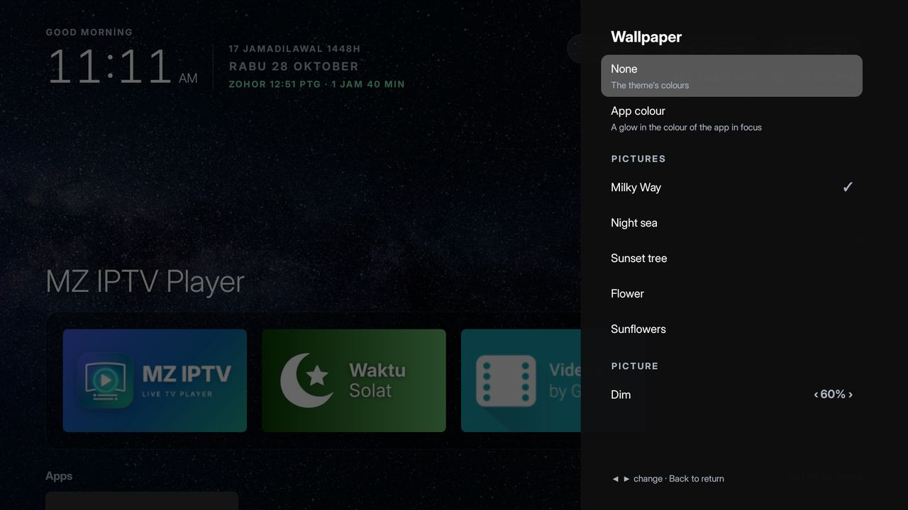
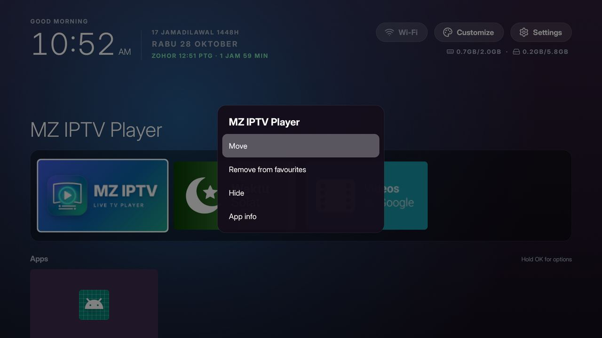

# MZ TX6 Home

A lightweight home screen for the Tanix TX6 Android TV box (Android 9), made to replace the slow stock launcher.
Plain Java on the Android framework only: no AndroidX, no libraries, no internet permission.


## Features

- **Clock and date** with a greeting, plus the Hijri date and the next prayer when Waktu Solat is installed
- **Memory and storage** under the buttons, as used/total ("0.7GB/2.0GB"), orange when RAM is nearly full
- **Favourites** in a band at the bottom of the first screen, all apps in a grid below; the focused app's name
  shown large above them
- **Wallpaper**: none (the theme's colours), a glow in the focused app's colour, five built-in pictures, or your
  own picture from the box or a USB stick, with a dim setting so the text stays readable
- **Hold OK on a tile** (or press Menu) to move it, add it to or remove it from favourites, hide it, or open App
  info, in a menu that follows the theme
- **Customize** side panel: 5 colour themes, wallpaper, apps per row, button labels, animations, memory and
  storage line, open an app on start, hidden apps, add-ons, Waktu Solat zone, set as default Home. Every change
  applies at once
- **Network label**: Wi-Fi, Ethernet, orange "No internet", red "Offline"
- **Clock screensaver** (Settings > Screen saver > MZ TX6 Clock)
- **Home key** goes back to the tile of the app you left; pressed on Home, it goes to the top
- Kept clear of the bottom edge of the screen, so things standing in front of the TV don't hide the focus
- Inter Display font and Lucide outline icons

| Wallpaper | Tile menu |
|---|---|
|  |  |

## Add-ons

Separate apps in [addons/](addons/). The launcher works without any of them.

| Add-on | What it does | On Home |
|---|---|---|
| [Waktu Solat](addons/waktu-solat/) | JAKIM e-Solat times for your zone, in Malay: the eight times, the next prayer with a countdown, the Hijri date | A tile; feeds the header (Hijri date, next prayer) |
| [Device Report](addons/device-report/) | A full report of the box (hardware, codecs, Home and Settings apps, every app with its permissions), saved as .txt and .json in Download | Customize > Add-ons |
| [Capacity Stats](addons/capacity-stats/) | Free and total memory and storage | Customize > Add-ons |

Device Report and Capacity Stats don't take a tile in MZ TX6 Home; other launchers and Settings still list them
as normal apps.


## Install on the box

Get the APKs from [Releases](../../releases) (or build them, below), then use any of:

- **LocalSend:** send the APKs from a phone or PC to the box and open them from LocalSend's received files.
- **USB stick:** copy the APKs to a stick and open them on the box with a file manager.
- **adb over the network:** turn on network debugging on the box, then `adb connect <box-ip>:5555` and
  `adb install -r <file>.apk`.

Allow installing from that app when the box asks. A newer APK installs over the old one and keeps your settings.

**Make it the Home app:** press Home on the remote and pick **MZ TX6 Home**. Choose *Just once* the first time;
once it works well, press Home again and choose *Always*. Customize > Default home opens the same choice.

**Safe to try:** the stock launcher stays installed and enabled. To go back, open MZ TX6 Home's App info and
clear its defaults, or uninstall it; the stock launcher takes over again.

## Permissions

| Permission | Why |
|---|---|
| Network state | The Wi-Fi / Ethernet / No internet label (read only) |
| Photos | Only for Customize > Wallpaper > Choose a picture, asked then. The picture is copied into the app, so Home never needs it afterwards |

No internet: anything online lives in an add-on (Waktu Solat fetches the JAKIM times and hands them over).

## Build

JDK 21, Android SDK 35:

```bash
./gradlew testReleaseUnitTest assembleRelease lintRelease
```

The APK is in `app/build/outputs/apk/release/`. Each add-on builds the same way from its own folder.

## Credits and licences

- Look and add-ons based on [Clean Your TV](https://github.com/Gathin23/cleanyourtv) (MIT, see
  [addons/LICENSE-cleanyourtv.txt](addons/LICENSE-cleanyourtv.txt))
- [Inter](https://rsms.me/inter/) by Rasmus Andersson (SIL Open Font License, see
  [FONT-LICENSE-OFL.txt](FONT-LICENSE-OFL.txt))
- Icons from [Lucide](https://lucide.dev) (ISC); app icons and banners are the project's own artwork
- Built-in wallpapers from [Pixabay](https://pixabay.com), see [CREDITS.md](CREDITS.md)
- Prayer times from [JAKIM e-Solat](https://www.e-solat.gov.my)
