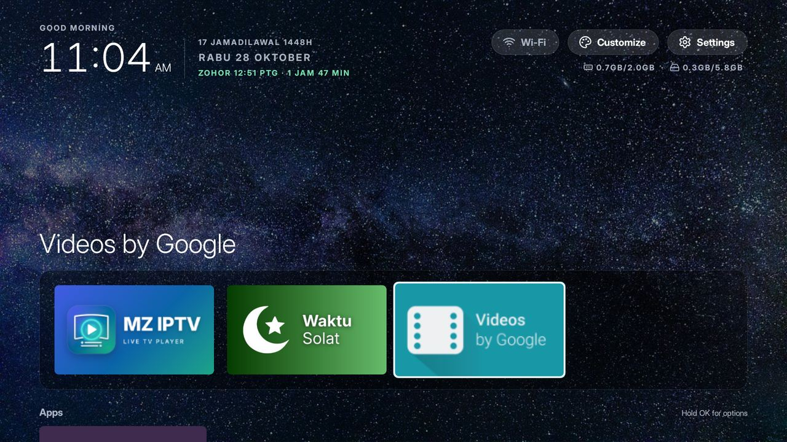
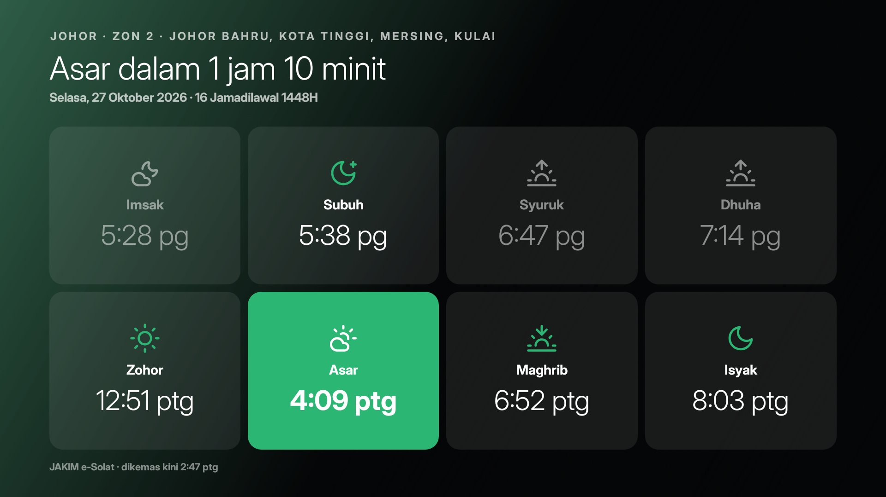

# MZ TX6 Home

A lightweight home screen for the Tanix TX6 Android TV box (Android 9), made to replace the slow stock launcher.
Plain Java on the Android framework only: no AndroidX, no libraries, no internet permission, a 120 KB APK.



## Features

- **Clock and date** with a greeting, plus the Hijri date and the next prayer when Waktu Solat is installed
- **Favourites** in a band at the bottom of the first screen, all apps in a grid below
- **Colour glow** taken from the focused app's banner, and its name shown large above the favourites
- **Hold OK on a tile** to move it, add it to or remove it from favourites, hide it, or open App info
- **Customize** side panel: 5 colour themes, apps per row, glow, button labels, animations, open an app on
  start, hidden apps, Waktu Solat zone, set as default Home. Every change applies at once
- **Network label**: Wi-Fi, Ethernet, orange "No internet", red "Offline"
- **Clock screensaver** (Settings > Screen saver > MZ TX6 Clock)
- **Home key** goes back to the tile of the app you left; pressed on Home, it goes to the top
- Kept clear of the bottom edge of the screen, so things standing in front of the TV don't hide the focus
- Inter Display font

## Add-ons

Separate apps in [addons/](addons/). The launcher works without them.

| Add-on | What it does |
|---|---|
| [Waktu Solat](addons/waktu-solat/) | JAKIM e-Solat times for your zone, in Malay: the eight times, the next prayer with a countdown, the Hijri date. Feeds the Home header. |
| [Capacity Stats](addons/capacity-stats/) | Free and total memory and storage |
| [Device Report](addons/device-report/) | A full report of the box (hardware, codecs, Home and Settings apps, every app with its permissions), saved as .txt and .json |



## Install on the box

Download the APKs from [Releases](../../releases). Then either:

- **USB stick:** copy the APKs to a stick, open them on the box with a file manager and allow installing from
  that app when asked.
- **adb over the network:** turn on network debugging on the box, then
  `adb connect <box-ip>:5555` and `adb install -r MZ-TX6-Home-1.2.apk`.

**Make it the Home app:** press Home on the remote and pick **MZ TX6 Home**. Choose *Just once* the first time;
once it works well, press Home again and choose *Always*. Customize > Default home opens the same choice.

**Safe to try:** the stock launcher stays installed and enabled. To go back, open MZ TX6 Home's App info and
clear its defaults, or uninstall it; the stock launcher takes over again.

## Build

JDK 21, Android SDK 35:

```bash
./gradlew testReleaseUnitTest assembleRelease lintRelease
```

The APK is in `app/build/outputs/apk/release/`. Each add-on builds the same way from its own folder.

## Credits and licences

- Look and add-ons based on [Clean Your TV](https://github.com/Gathin23/cleanyourtv) (MIT, see
  [addons/LICENSE-cleanyourtv.txt](addons/LICENSE-cleanyourtv.txt))
- [Inter](https://rsms.me/inter/) by Rasmus Andersson (SIL Open Font License, see
  [FONT-LICENSE-OFL.txt](FONT-LICENSE-OFL.txt))
- Prayer times from [JAKIM e-Solat](https://www.e-solat.gov.my)
- Icons from [Lucide](https://lucide.dev) and [Phosphor](https://phosphoricons.com) (MIT), and Feather
